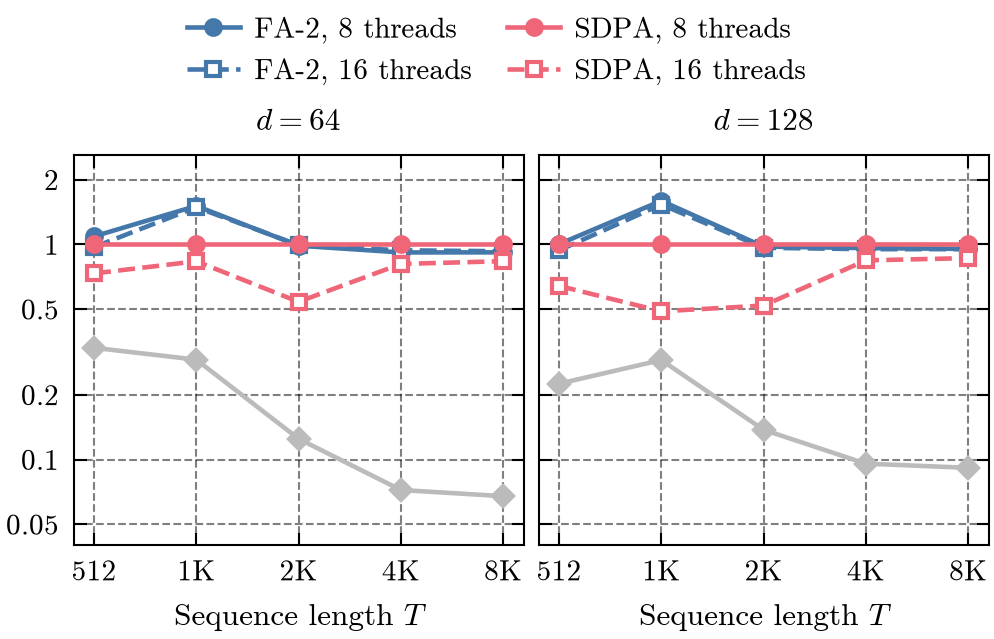
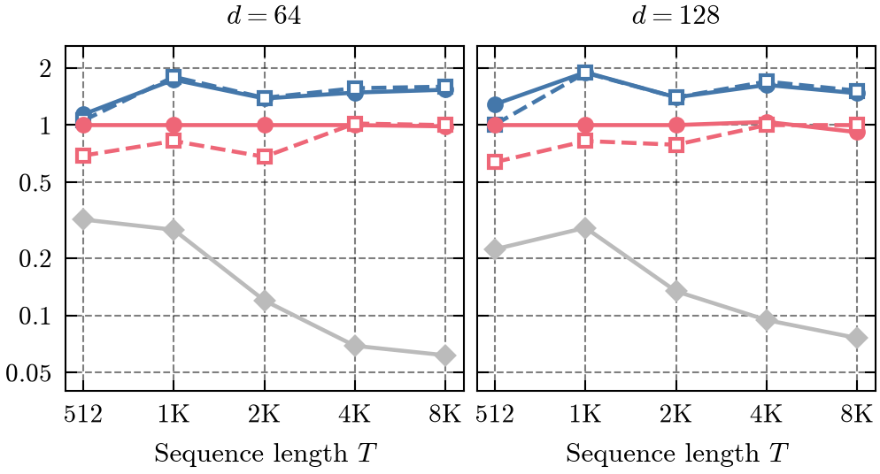
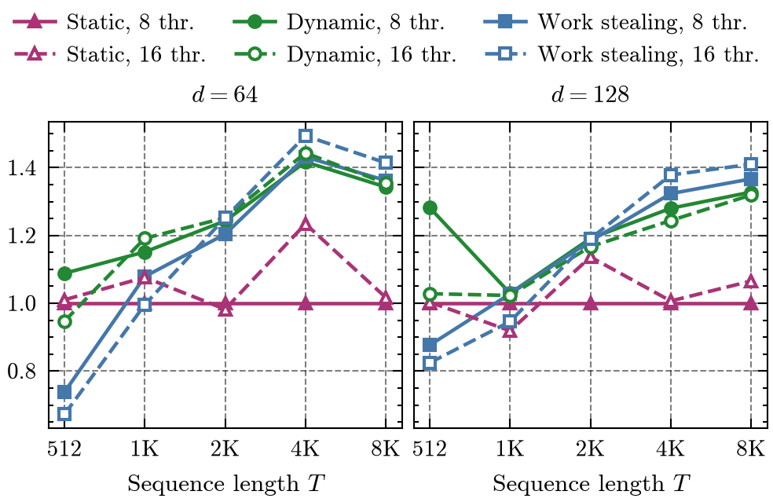
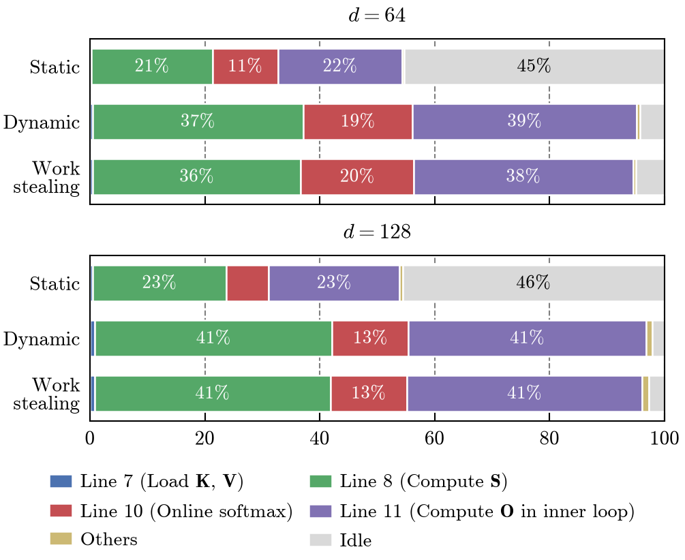

Performance Evaluation of FlashAttention-2 for Inference on CPU
=======================
This repository contains implementations of the FlashAttention-2 forward kernel run on CPU. Standard attention baselines are also provided. For causal attention, three scheduling strategies are implemented: static, centralized dynamic, and work-stealing.

The technical report, including algorithm derivation, complexity analysis, and interpretation, is available here:
* [Performance Evaluation of FlashAttention-2 for Inference on CPU (PDF)](./flash-attention2-cpu-report.pdf)

Abstract
------------
**TL;DR:** We evaluate the performance of FlashAttention-2 forward kernel for inference on CPU.

FlashAttention has revolutionized transformer training and inference on GPU by minimizing memory I/O, yet its behavior on CPU remains underexplored. We evaluate the FlashAttention-2 (FA-2) forward kernel for inference on a single CPU against standard attention and PyTorch's scaled dot-product attention (SDPA). For masked attention, we compare three scheduling strategies for parallelizing the kernel. We further profile the runtime breakdown of the kernel's algorithmic steps. For self-attention, FA-2 performs on par with SDPA; for masked attention, it is 1.4× to 1.7× faster than SDPA on long sequences. Per-thread profiling shows that static scheduling leaves 45% of thread time idle on the triangular masked workload; dynamic and work-stealing scheduling reduce it to 2–5% and speed up the kernel by up to 1.4×. Our analysis serves as a preliminary exploration of efficient attention computations in resource-constrained settings, including CPU-only inference.

<br>
<p align="center">
  
  <br>
  <em>Figure 1: Computation of the FlashAttention-2 forward kernel.</em>
</p>

Results
------------
We benchmark on Intel Core i9-11900K (8 cores / 16 threads, AVX-512) with GCC 11 and Eigen 5.0.1.
### Self-Attention

FA-2 is on par with SDPA for T ≥ 2K (0.93–0.99×) and up to 1.60× faster at T = 1K.

<p align="center">
  
  <br>
  <em>Figure 2: Speedup over PyTorch SDPA, self-attention (log scale). The gray line is single-threaded standard attention.</em>
</p>

### Masked Attention

FA-2 is the fastest at every T: 1.39–1.69× faster than SDPA for T ≥ 2K, up to 1.89× at T = 1K. FA-2 skips the key blocks above the diagonal; SDPA does not get faster with the mask.

<p align="center">
  
  <br>
  <em>Figure 3: Speedup over PyTorch SDPA, masked attention (log scale). Legend as in Figure 2.</em>
</p>

Static scheduling splits the rows evenly, so the thread with the last rows does most of the masked triangle. Dynamic and work-stealing scheduling are 1.18–1.43× faster than static for T ≥ 2K (8 threads); work stealing is slower at T = 512, where there are too few blocks to steal.

<p align="center">
  
  <br>
  <em>Figure 4: Speedup of each scheduling strategy for masked FA-2 over static scheduling with 8 threads.</em>
</p>

<p align="center">
  
  <br>
  <em>Figure 5: Share of total thread time (%) per step of masked FA-2, T = 8K, M = 32 KiB, averaged over 8 and 16 threads. Line numbers refer to Algorithm 1 in the report. Idle is time spent waiting for the slowest thread: 45–46% with static scheduling, 2–5% with dynamic and work stealing.</em>
</p>

Repository Layout
------------
```
csrc/         C++ kernels: standard attention, FA-2 (serial, OpenMP, masked schedulers, profiling), matrix I/O
pyimpl/       NumPy and Numba implementations
benchmarks/   Benchmark drivers for each implementation and PyTorch SDPA
scripts/      Test set generation, full benchmark sweep (run.sh), paper figures (plot.py), paper numbers (paper_stats.py)
```

Dependencies
------------
- **Python:** numpy, scipy, numba, pandas, matplotlib, SciencePlots, PyTorch (tested with 2.6.0, for the SDPA baseline)
- **C++:** OpenMP, CMake ≥ 3.16, GCC ≥ 10 (or another C++17 compiler). CMake downloads Eigen 5.0.1 (header-only) at configure time

Usage
-----
```bash
cmake -S . -B build -DCMAKE_CXX_COMPILER=g++-11 && cmake --build build --parallel
bash scripts/run.sh
```

Run from the repo root. Logs go to `outputs/<impl>/runtime.csv`; plots go to `plots/`. `python scripts/paper_stats.py` prints the numbers quoted in the paper.

Each benchmark resumes from existing CSV entries if interrupted.
